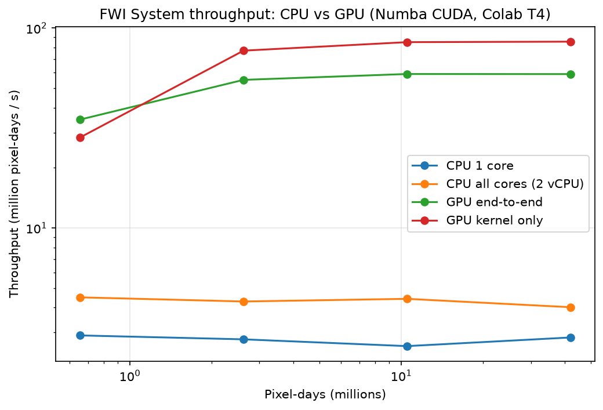

# GPU-Accelerated Canadian Fire Weather Index (FWI)

Computes the full Canadian Forest Fire Weather Index System (FFMC, DMC, DC, ISI, BUI, FWI) for every pixel of a large weather grid on an NVIDIA GPU with **Numba CUDA**.

## Approach
- Each day depends on the previous day, so time runs in order. Pixels are independent, so **one CUDA thread computes one pixel** and loops through the days.
- Moisture-code state (FFMC, DMC, DC) stays in **registers**. Only the weather inputs and FWI output touch global memory.
- A 2D grid with blocks of (32, 8) threads keeps memory reads **coalesced**.
- The same scalar equations compile for both CPU (`@njit`) and GPU (`@cuda.jit(device=True)`), so the comparison is like-for-like.

## Validation
- Reproduces the Van Wagner & Pickett (1985) reference case exactly: FFMC 87.7, DMC 8.5, DC 19.0, ISI 10.9, BUI 8.5, FWI 10.1.
- GPU output matches the CPU implementation to within about 5e-5 (float32 storage).

## Results (Google Colab, NVIDIA T4, 10 days per grid)

| Grid | CPU 1 core | CPU all cores | GPU kernel | GPU end-to-end | Speedup (kernel / e2e vs all cores) |
|---|---|---|---|---|---|
| 256² | 225.9 ms | 145.7 ms | 23.1 ms | 18.8 ms | 6.3× / 7.7× |
| 512² | 945.2 ms | 611.2 ms | 34.0 ms | 47.6 ms | 18.0× / 12.8× |
| 1024² | 4087.5 ms | 2371.3 ms | 123.3 ms | 178.0 ms | 19.2× / 13.3× |
| 2048² | 14804.0 ms | 10444.0 ms | 490.5 ms | 712.7 ms | 21.3× / 14.7× |

At 2048² the GPU processes about **85 million pixel-days per second**, which is 30× faster than one CPU core.

**Caveat:** Colab's CPU has only 2 vCPUs, so "all cores" is a modest baseline. At 256², timing noise is larger than the measurement.

## Run it
Open `GPU_FWI_Numba_CUDA.ipynb` in Google Colab, choose Runtime → Change runtime type → T4 GPU, and run all cells.

## Roadmap
- [ ] float32 math + `fastmath` (the T4's FP64 rate is about 1/32 of FP32)
- [ ] Profile with Nsight Compute
- [ ] Block-size sweep
- [ ] Real ERA5 / IMD gridded weather over India
- [ ] CuPy RawKernel version for comparison

## Files
- `GPU_FWI_Numba_CUDA.ipynb`: full notebook (equations, CPU baselines, CUDA kernel, validation, benchmark, India-scale demo)
- `fwi_core.py`: the FWI equations as plain scalar functions
- `results/`: benchmark chart

## Reference
Van Wagner, C.E. (1987). *Development and Structure of the Canadian Forest Fire Weather Index System.* Canadian Forestry Service, Forestry Technical Report 35.
